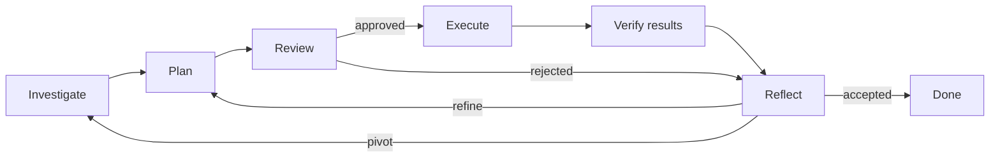

# Agent Workflow Kit

**Keep research, execution, and improvement moving across sessions.**

An agent skill for research and iterative project improvement: investigate a
question, build and review a plan, execute it, verify the result, and decide what
comes next. Goals, evidence and progress stay with the task, for a single cycle
or work continued across sessions and scheduled wakeups.

[中文](README.zh-CN.md) · [Quick start](#quick-start) · [Workflow](#workflow) · [Monitoring](#monitoring-and-continuation) · [Documentation](#documentation)

## What you can use it for

| Task | What a cycle produces |
|---|---|
| Research and model experiments | A testable hypothesis grounded in sources and local evidence, a reviewed design, and a result-based next decision |
| Code and performance optimization | An inspected execution path, an evidence-backed change, and a comparison covering gains and regressions |
| Learning and method validation | A defined knowledge gap, relevant material and practice, and an independent check for the next learning step |
| Data processing | Verified inputs and coverage, a concrete partition action, completeness checks and a confirmed place to resume |

- **Ground the plan:** inspect the project and retrieve relevant documentation or papers, retaining sources and assumptions.
- **Review before committing:** assess scientific merit, feasibility and acceptance methods.
- **Let results guide the next action:** distinguish faults, valid negative results and improvements before continuing.
- **Resume unfinished work:** reconcile saved task records with actual execution status.

## Quick start

### 1. Install

Download and extract the project. From its root, copy the full skill into the
Codex user skill directory. The command fails if the destination exists,
preserving an existing installation.

```bash
python -c 'from pathlib import Path; import shutil; shutil.copytree("skills/agent-workflow", Path.home() / ".codex/skills/agent-workflow")'
```

For another agent, copy `skills/agent-workflow/` into its skill directory, or ask
a host without discovery to read its `SKILL.md`. Skill use needs neither the
Python runtime nor LangGraph; the copy command above needs Python.

### 2. Give it a task

Adapt the goal, acceptance and limits in this example to your existing project:

```text
$agent-workflow

Goal: investigate and reduce this project's batch-processing time while preserving output content and order.
Investigation: inspect actual callers, configuration, tests and saved measurements; consult official documentation or primary papers as needed.
Plan: explain the evidence, smallest change, baseline, comparison method and estimated resources; review merit and feasibility before execution.
Acceptance: compare repeated timings on fixed inputs in the same environment; preserve output, pass existing tests, and report regressions and uncertainty.
Permission: ordinary local edits and tests are authorized. Do not alter original data, disclose private material or publish.
Limits: at most three cycles and twenty minutes of total execution; stop on acceptance or when unable to continue.
Continuity: keep records in .agent-workflow/batch-optimization/ and use each result to decide the next action.
Notifications: report completion, failure or a decision I need to make; keep healthy waits quiet.
```

When the baseline is missing, plan and review its measurement first. Reuse
applicable evidence. More examples and a complete walkthrough are in
[task design and examples](skills/agent-workflow/references/workflow-design.md).

### 3. Continue the same task

```text
$agent-workflow
Continue the task in .agent-workflow/batch-optimization/.
Read its records, reconcile actual execution status, and advance unfinished work.
```

## Workflow



Investigation can also occur while planning, reviewing or reflecting. Inspect
implementation and records for project behavior; consult primary sources for
external methods. **Pre-execution review** asks whether the plan is justified,
feasible and testable. **Post-execution verification** establishes what happened
and what the result supports. Approval permits the agreed exploration or test.

Known, cheap, reversible work can use **plan → execute → verify**. New experiments
and consequential uncertainty use the full route. Reflection should change a
next decision; persistent non-improvement prompts a broader review while
retaining negative evidence and spent resources.

## Monitoring and continuation

**The skill guides continuation. The host supplies wakeups, job status and
execution tools.** Installing the skill does not create a schedule.

| Observed state | Next action |
|---|---|
| Original job still running | Check identity and health; await completion or the next check |
| Job ended and results are available | Verify saved outputs, reflect and advance authorized work |
| Previous launch has an uncertain outcome | Reconcile the original executor and observed effects first |
| Paused, waiting on a dependency, or complete | Save the specific state and follow its wake or monitor-exit policy |

Healthy unchanged checks stay quiet. Timers, completion events, notification
channels and active cancellation come from the host. See
[monitoring setup and failure handling](docs/monitoring.zh-CN.md) (Chinese).

## Choose an integration

| Mode | What you provide | Best fit |
|---|---|---|
| Install the skill | An agent with project/execution tools and task records | Research, improvement and continuation in an existing agent |
| Skill + Python runtime | Task contract and reasoning/review/execution/verification callbacks | Programmatic state transitions and duplicate-call controls |
| Add LangGraph | Optional dependency and the same runtime | Projects that already use graph routing |

File mode uses existing project records or templates; Python mode uses SQLite.
The host supplies models, retrieval and scheduling. The runtime is a local
reference implementation. See [architecture](docs/design.zh-CN.md) (Chinese) for
component responsibilities and limits.

## Try a runnable example

Requires Python 3.11 or newer. No model, key or dataset is needed. From the
project root, run this same command three times:

```bash
python scripts/demo_workflow.py --workspace ../workflow-demo-private --steps 6
```

Two synthetic text-processing attempts fail; the third changes approach and
reaches acceptance, returning `done`, `cycles: 3`. Scripted callbacks demonstrate
persistence and continuation across processes. See the
[runtime guide](docs/runtime.zh-CN.md) (Chinese) for per-wake outputs, routine mode
and LangGraph instructions.

## Documentation

| Question | Read |
|---|---|
| How do modules work and exchange evidence? | [Architecture and module collaboration](docs/design.zh-CN.md) — Chinese |
| How do wakeups, monitoring and continuation connect? | [Monitoring integration and recovery](docs/monitoring.zh-CN.md) — Chinese |
| How do I connect models, executors and LangGraph? | [Python runtime guide](docs/runtime.zh-CN.md) — Chinese |
| What are the defaults, units and tuning limits? | [Parameter reference](skills/agent-workflow/references/parameters.md) |
| How do I design an experiment, optimization or learning task? | [Task design and examples](skills/agent-workflow/references/workflow-design.md) |
| What has been verified and what remains untested? | [Validation record](evals/validation.md) |

The public package contains generic implementation and synthetic examples.
Actual task code, data, logs and credentials stay in the task environment.

[MIT](LICENSE) · [Contributing](CONTRIBUTING.md) · [Changelog](CHANGELOG.md)
