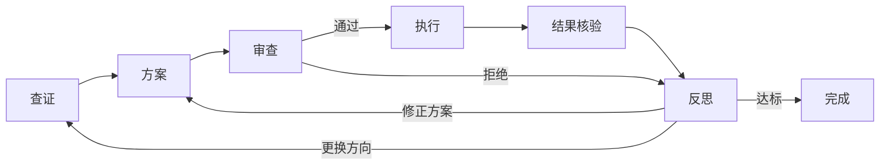

# Agent Workflow Kit

**给出一个需求，让 agent 通过执行、反思和迭代逐步达成目标。**

适用于需要多轮尝试的科研与项目优化，例如通过多次实验、模型训练和方案调整，改善结果与评价指标。每轮先查证问题、制定并审查方案，再执行、核验结果、总结得失，把反思转化为下一轮的具体改进。

目标、证据、已尝试方案和进度随任务保存，支持跨会话与定时接续。agent 根据实际结果，在约定的权限、资源和验收条件内决定继续、转向或停止。

工作流本身也能改进：按目标发现缺少的能力，寻找合适的 skill，并用验证过的经验调整后续做法。

[English](README.md) · [开始使用](#开始使用) · [工作流程](#工作流程) · [监视与接续](#监视与接续) · [详细文档](#详细文档)

## 能用它做什么

| 场景 | 一轮工作要得到什么 |
|---|---|
| 科研与模型训练 | 从文献和项目证据形成可检验假设，审查方案，通过多轮实验或训练比较指标、总结得失并调整下一轮方案 |
| 代码与性能优化 | 找到真实执行路径，提出有依据的改动，对照验证收益及回退 |
| 学习与方法验证 | 找准知识缺口，选择资料和练习，用独立检查决定下一轮学习 |
| 数据处理 | 核对输入与覆盖范围，执行具体分区，检查完整性，从已确认的位置继续 |

- **方案有依据：** 按需检查项目、查官方文档或论文，保留来源与适用条件。
- **投入前先判断：** 审查科学依据、工程可行性和验收方法。
- **结果决定下一步：** 区分故障、有效负结果和实际改善，反思后形成具体行动。
- **中断后能接续：** 读取任务记录与真实作业状态，推进未完成的部分。
- **按目标补齐能力：** 按需发现和组合 skill，验证后保留有用的流程改进。

## 开始使用

### 1. 安装

下载并解压本项目，从项目根目录执行以下命令，将完整 skill 复制到 Codex 用户技能目录。目标已存在时会报错，保留已有安装。

```bash
python -c 'from pathlib import Path; import shutil; shutil.copytree("skills/agent-workflow", Path.home() / ".codex/skills/agent-workflow")'
```

其他 agent 可复制 `skills/agent-workflow/` 到其技能目录；不支持技能发现的宿主可直接读取其中的 `SKILL.md`。安装 skill 无需 Python 运行层或 LangGraph；上面的复制命令需要 Python。

### 2. 给它一个任务

以下是用于已有项目的示例请求。按实际任务修改目标、验收和限制：

```text
$agent-workflow

目标：研究并减少当前项目的批处理耗时，保持输出内容与顺序不变。
查证：检查实际调用链、配置、测试和已有测量；按需查官方文档或原始论文。
方案：说明依据、最小改动、基线、比较方法和预计资源；执行前核验科学性与可行性。
验收：在固定输入和相同环境下多次比较耗时；输出一致，已有测试通过，报告回退与不确定性。
权限：常规本地修改和测试已授权；不改原始数据，不上传私有内容，不发布。
限制：最多三轮，总执行时间二十分钟；达标或无法继续时停止。
接续：记录保存在 .agent-workflow/batch-optimization/，每轮根据结果决定下一步。
通知：完成、失败或需要我决定时通知，正常等待保持安静。
```

缺少基线时，先安排并审查基线测量；已有证据充分时直接复用。其他任务示例与一轮完整推演见[任务设计与案例](skills/agent-workflow/references/workflow-design.md)。

### 3. 继续同一个任务

```text
$agent-workflow
继续 .agent-workflow/batch-optimization/ 中的任务。
读取当前记录并核对真实执行状态，推进尚未完成的步骤。
```

## 工作流程



查证也可发生在规划、审查或反思中：项目行为看源码与记录，外部方法看相关原始来源。**执行前审查**判断方案是否值得、能否完成、怎样验收；**执行后核验**判断实际发生了什么、是否有效。审查通过允许进行约定的探索或验证。

已知、廉价、可逆的工作可走 **方案 → 执行 → 核验**。新实验与有重要不确定性的优化保留完整路线。反思应改变下一步选择；连续没有改善时重新判断方向，保留负结果和已用资源。

## 按目标适配与进化

遇到具体能力缺口时，先检查已有 skill；不够用时，再通过可用的 `find-skills` 或宿主检索工具寻找候选，核对适用条件、依赖和权限。找到 skill 后，可以让它承担某一步，也可以调整当前任务的模块组合和检查方法。

反思也可改进工作流本身：从真实错误中提出小改动，在独立候选版本中比较原版与新版的行为，检查回退，再决定采用或撤回。默认改进留在当前任务；通用 skill 的修改需要覆盖该范围的授权和回归验证，运行中的任务保持原版本。

这是一套由 agent 执行的改进方法；检索、安装、编辑和评测工具由宿主提供。默认每个能力缺口最多两次检索、深入检查三个候选、评估一个候选版本，开销计入原任务限制。没有合适候选或验证证据时，保留原流程。详见[技能发现与进化](skills/agent-workflow/references/skill-evolution.md)和[参数参考](skills/agent-workflow/references/parameters.md#capability-adaptation-settings)。

## 监视与接续

**skill 决定如何继续；宿主负责何时唤醒，并提供作业状态和执行工具。** 安装本项目不会自动开启定时任务。

| 观察到的状态 | 下一步 |
|---|---|
| 原作业仍在运行 | 核对身份与健康状态，保留原作业，等待完成事件或下次检查 |
| 作业已结束且结果可用 | 核验保存结果，反思后推进已授权的下一步 |
| 上次启动是否成功不明 | 核对原执行器与实际效果，再决定如何接续 |
| 暂停、外部条件未满足或任务完成 | 保存明确状态，等待触发条件或按用户要求结束监视 |

正常无变化的检查保持安静。定时器、完成事件、通知渠道和运行中取消由宿主接入。设置步骤、状态判断和故障处理见[监视与自动推进](docs/monitoring.zh-CN.md)。

## 选择接入方式

| 方式 | 需要准备什么 | 适合谁 |
|---|---|---|
| 安装 skill | 可读项目与执行工具的 agent、任务记录 | 直接在现有 agent 中研究、改进与接续 |
| skill + Python 运行层 | 任务约定、推理／审查／执行／核验回调 | 需要用程序约束状态转换与重复调用的集成 |
| 再接 LangGraph | 可选依赖和同一运行层 | 已使用 LangGraph，希望以图路由模块的项目 |

文件模式使用项目记录或文件模板；Python 模式使用 SQLite。模型、网络检索和调度器来自宿主。当前运行层是本地参考实现，具体能力和边界见[架构说明](docs/design.zh-CN.md)。

## 先看一个可运行示例

需要 Python 3.11 或更新版本，无需模型、密钥或数据集。从项目根目录运行同一命令三次：

```bash
python scripts/demo_workflow.py --workspace ../workflow-demo-private --steps 6
```

前两次合成文本处理未通过，第三次转向后达到验收，返回 `done`、`cycles: 3`。示例使用预编写回调，展示状态保存与跨进程接续。逐次输出、例行路线和 LangGraph 用法见[运行层接入](docs/runtime.zh-CN.md)。

## 详细文档

| 你想了解什么 | 阅读 |
|---|---|
| 每个模块怎样工作，信息如何传递 | [架构与模块协作](docs/design.zh-CN.md) |
| 如何设置唤醒、监视和自动推进 | [监视接入与故障处理](docs/monitoring.zh-CN.md) |
| 如何接入模型、执行器与 LangGraph | [Python 运行层指南](docs/runtime.zh-CN.md) |
| 参数默认值、单位、调整方法及限制 | [参数参考](skills/agent-workflow/references/parameters.md) |
| 如何设计自己的实验、优化或学习任务 | [任务设计与案例](skills/agent-workflow/references/workflow-design.md) |
| 如何按目标寻找 skill，并验证自身流程的改进 | [技能发现与进化](skills/agent-workflow/references/skill-evolution.md) |
| 已验证什么、哪些仍待验证 | [验证记录](evals/validation.md) |

公开包使用通用实现与合成示例。实际任务的代码、数据、日志和凭据保留在任务环境中。

[MIT](LICENSE) · [贡献指南](CONTRIBUTING.md) · [更新记录](CHANGELOG.md)
