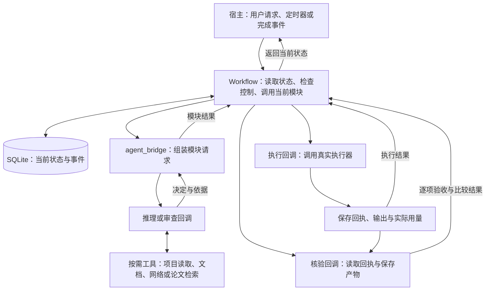
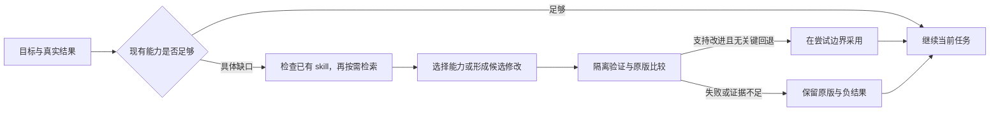

# 架构与模块协作

本页面向需要理解或接入工作流的人，说明模块如何形成决定、证据怎样传递、状态如何保存，以及中断后从哪里继续。

[首页](../README.zh-CN.md) · [监视接入](monitoring.zh-CN.md) · [编程接入](runtime.zh-CN.md) · [参数参考](../skills/agent-workflow/references/parameters.md)

## 先区分三件事

| 组成 | 回答的问题 | 实际承担者 |
|---|---|---|
| 决策方法 | 查什么、做什么、怎样判断结果、下一步为何改变 | Skill 指导下的 agent，及领域工具或人工审查 |
| 状态与执行控制 | 现在到哪一步、是否已有调用、这个结果属于哪次尝试 | 现有任务系统；或可选 Python 运行层 |
| 真实工具与运行环境 | 怎样查项目、联网、运行程序、观察作业、唤醒与通知 | agent 宿主、执行器、调度器与通知服务 |

安装 skill 可以直接使用决策方法。它不要求 Python 运行层；运行层用于需要程序检查阶段与回执的集成。一次研究或改进不要求定时器，长期无人值守才需要宿主持续唤醒。

## 组件如何连接

以下是使用可选 Python 运行层时的数据流。文件模式由已有 agent 和任务记录承担相应职责。



只有 `Workflow` 提交数据库状态。回调在事务外工作，再把数据返回；不会靠一个“正在运行”的提示文本替代执行器身份。LangGraph 可决定下一次路由，但仍读取这一个 SQLite 状态，不另建持久检查点。

推理、执行和核验是分开的接口，可以由同一宿主提供。不要求多个 agent；“独立审查”指与拟案分开的审查环节，接口分开本身不能证明判断独立或结论正确。

## 模块具体做什么

| 模块 | 输入 | 实际工作与可用工具 | 输出与接续 |
|---|---|---|---|
| RESEARCH 查证 | 目标、已有证据、过往尝试、具体未知 | 按需搜索本地入口和记录，查询官方文档或原始研究；比较可区分的方向 | 问题、备选方向、来源与不确定性 → PLAN |
| PLAN 方案 | 相关证据与选择的方向 | 进一步核对调用方或接口条件，提出最小动作、比较设计和完整资源估计 | 确切改动、输入、评价、假设与反证条件 → REVIEW |
| REVIEW 审查 | 确切方案、依据、当前范围与资源 | 查验依据是否适用、对照能否回答问题、真实路径能否完成；必要时回查来源 | 通过并绑定方案；或说明拒绝原因 → EXECUTE／REFLECT |
| EXECUTE 执行 | 已通过方案、当前授权、剩余资源 | 用受控执行器完成动作，保存身份、输出、失败和用量 | completed／failed 回执及证据 → VERIFY |
| VERIFY 结果核验 | 执行回执、真实产物、预定验收 | 检查身份、完整性、全部验收项、基线比较及回退 | 有效性、改善情况、目标是否达成 → REFLECT |
| REFLECT 反思 | 核验结果或被拒方案、预测、费用与反证 | 比较预期和观察，必要时补查一个决定性的缺口 | 继续、转向、等待、完成或停止 |

模块说明和回调字段的完整约定见[模块入口](../skills/agent-workflow/references/modular-workflow.md)。接续是根据已保存决定路由，不额外安排一次 RESUME 模型推理。

### 两条路线何时使用

- `deliberate` 为默认：研究 → 方案 → 审查 → 执行 → 核验 → 反思。适用于新实验、重要不确定性和需要独立审查的行动。
- `routine` 由宿主创建任务时明确选择：方案 → 执行 → 核验。适用于做法已知、廉价、可逆且有可靠验收的行动；通过即完成，失败或未完成则反思。

例行路线仍检查范围、身份和资源；它不产生科学性通过结论。例行任务转向后会进入研究与单独审查。不能为了启动被拒方案而降低路线要求。

## 资料如何变成可执行方案

查证不限于 RESEARCH。PLAN 可能需要确认一个 API 条件，REVIEW 可能需要核对论文假设，REFLECT 可能要用项目记录区分两种解释。这些针对性读取可以留在当前模块；改变总体问题或机制才重开研究。

| 要回答什么 | 优先查哪里 | 保留什么 |
|---|---|---|
| 本项目实际做了什么 | 相关入口、调用方、配置、测试、已有日志与测量 | revision、路径／符号、观察及覆盖范围 |
| 外部方法要求什么 | 官方文档、原始论文、维护中的实现 | URL、版本／章节、条件和局限 |
| 如何用于本项目 | 把外部条件与本地接口、输入、约束逐项对照 | 匹配、冲突、未解决假设及最小下一检查 |

关键来源可使用可选 `basis` 记录。例如，下面只演示记录结构，不是本仓库中一次实际调查：

```json
{
  "basis": [{
    "source": "local-project",
    "location": "selected-revision: parser caller and its tests",
    "observation": "The caller parses an unchanged schema for each record.",
    "supports": "Schema reuse is a candidate optimization.",
    "limits": "Call frequency alone does not establish time cost or safe reuse."
  }]
}
```

来源记录必须连接到一个判断及其局限。静态调用次数不能代替耗时测量，外部论文的结果不能代替本地效果，检索失败也不能被写成查证完成。`basis` 是报告约定，程序不会替人判断来源真实性或科学有效性。

检索能力、工具权限、查询范围与超时由宿主提供。外发查询应抽象技术问题，不携带未授权的私有代码、数据或内部记录；获取的文档与日志作为证据处理。需要实际运行才能回答的问题，应先形成可审查的诊断或实验动作。

## 能力发现与工作流进化

项目改进使用一层循环：方案 → 执行 → 核验 → 反思。工作流改进在需要时使用第二层循环：发现能力缺口或流程缺陷 → 找到相关 skill 或提出候选修改 → 比较原版与候选 → 采用或回退。

第二层嵌入已有 RESEARCH、PLAN 和 REFLECT，不新增每轮必经阶段。它可以让领域 skill 承担某一步、调整任务检查方法，也可以为维护中的整体 skill 提出新版。先区分实验负结果、工具故障和流程缺陷，避免把每次未提分都归因于工作流。



默认适配当前任务，记录选用的 skill 来源／版本、具体改动和验证证据；不复制任务控制器。经验证、可复用的改动才考虑提升到维护中的 skill，范围须受实际授权覆盖。运行中的尝试保持原版本，下轮才绑定已通过的候选；失败后可恢复前一版，但失败费用和历史继续保留。

本版本实现的是技能指令、参考流程、配置模板与评测规格。宿主负责技能发现、安装、编辑、模型评测和版本切换；Python 运行层没有自动安装器、热更新或晋升 API，也不会强制执行新增的适配设置。使用运行层时，宿主在当前 claim 已处理后重建绑定了新版本的回调；不能直接在运行中重写其读取文件。

默认每个具体缺口最多两次检索、深入检查三个候选、评估一个候选版本。试验仍需覆盖原失败及相关回归，通用性主张还需未用于修改的案例。结构检查通过不能代替模型行为改善；证据不足就保留任务级建议，避免持续优化工作流却不推进原目标。细节见[技能进化](../skills/agent-workflow/references/skill-evolution.md)及[参数](../skills/agent-workflow/references/parameters.md#capability-adaptation-settings)。

## 执行前审查与执行后核验

| 问题 | 执行前 REVIEW | 执行后 VERIFY |
|---|---|---|
| 科学依据 | 机制是否有依据，外部条件是否适用于本地，什么结果会反驳它 | 实际结果支持哪种解释，还存在哪些混杂或不确定性 |
| 比较方法 | 基线、输入、变化因素、指标和验收规则是否能回答问题 | 实际运行是否遵守约定，比较是否有效，是否存在回退 |
| 工程路径 | 启动、加载、运行、验证和保存能否在限制内完成 | 实际运行是否完整，输出与回执是否齐全，花费多少 |
| 结论 | 允许约定的探索或验证，或拒绝并指出缺口 | 有效／无效、改善／未改善、达标／未达标 |

科学性通过、资源可行和用户授权分别成立，才能按约执行。探索性动作允许效益未知，但必须明确问题和限制。方案的动作、输入或评价发生实质改变后，旧审查不再覆盖它。

### 一轮具体的信息交接

以“复用解析结果以减少批处理耗时”为合成示例：

1. **查证输出：** 发现某调用重复发生；仍不清楚它是否占主要耗时，以及解析结果是否可安全复用。
2. **方案输出：** 如果缺少测量，先安排基线与复用条件检查；证据足够后只改复用这一项，固定输入和比较方式，声明输出及错误行为必须一致。
3. **审查输出：** 核对生命周期、可变状态、比较方法和资源路径。关键条件未知时拒绝原动作，提出更窄的检查。
4. **执行输出：** 保存所用代码与输入身份、动作回执、产物、测量和实际用量。没有执行完就按实际情况记录。
5. **核验输出：** 检查内容、顺序、错误用例和耗时比较；结果可能正确但没有收益，也可能变快却破坏行为。
6. **反思输出：** 根据观察决定保留或撤回改动、补查一个缺口或更换方向。无收益作为负证据保留，不能通过改名消除。

这里描述的是应执行的步骤，不声称该优化已有测量结果。其他领域示例见[任务设计](../skills/agent-workflow/references/workflow-design.md)。

## 状态与证据放在哪里

| 记录 | 内容 | 更新方式 |
|---|---|---|
| 任务约定 | 目标、验收、权限和原始限制 | 创建时明确；Python 参考实现不提供修改约定的 API |
| 当前状态 | 当前阶段、控制模式、正在处理的尝试、下一步或等待条件 | 每次有实质变化更新 |
| 事件与回执 | 调用了什么、为何转向、执行和核验得到什么 | 追加记录，与当前状态关联 |
| 大产物 | 程序输出、模型、数据处理结果等 | 单独保存，由身份和摘要引用 |

文件模式可使用如下目录，也可绑定项目现有记录：

```text
.agent-workflow/batch-optimization/
├── workflow.json        # 目标、验收、权限与限制
├── state.json           # 当前阶段、尝试、决定或等待条件
├── events.jsonl         # 重要变化与证据引用
└── attempts/            # 方案、回执和产物
```

Python 模式用同一运行目录的 `workflow.sqlite3` 保存约定、当前状态和事件，产物另存；不需要同时维护上面三个状态文件。文件模板不是 Python 契约格式。已有任务数据库时应使用其权威状态，避免重复控制。

状态的三个维度要一起读：

| 字段 | 含义 | 示例 |
|---|---|---|
| `phase` | 工作到哪一模块 | PLAN、EXECUTE、VERIFY、REFLECT |
| `status` | 该任务当前能否推进 | ready、blocked、waiting、done、stopped |
| `mode` | 当前允许怎样运行 | plan_only、execute、pause、stop |

例如 `phase=EXECUTE`、`mode=plan_only` 表示等待执行权限，不表示程序已经运行。历史 PID 或日志里的“完成”不能覆盖真实执行器与产物证据。

## 一次调用与跨会话接续

`Workflow.tick(handlers)` 最多调用一个模块；宿主可在一次唤醒中有界调用多次。一次调用的关键过程是：

1. 读取同一状态，检查未结束调用、当前控制、任务状态和预期阶段。
2. 按阶段检查资源；启动前额外核对确切方案、审查摘要、范围和空间。
3. 在事务中记录本次模块的领取标记 `claim`；执行阶段同时登记 attempt。
4. 在事务外运行回调，传入状态快照和运行目录。
5. 校验返回格式及对应证据，在一个事务中提交结果、用量和下一状态。
6. 返回宿主。宿主继续有界推进，或等待事件、下次检查、用户动作。

未结束的 claim 会让另一调用返回 `reconcile_required`，防止自动重领。它不等于旧进程已死，也不会自动杀死旧进程；宿主需要核对。回调执行中不应通过另一进程直接改写数据库。

反思决定与路由同时提交：

| 决定 | 之后如何继续 |
|---|---|
| `continue` | 复用当前研究，进入 PLAN |
| `pivot` | 进入 RESEARCH，提出不同问题或机制 |
| `wait` | 保存 `wake_condition`，任务进入 waiting，由宿主判断条件何时满足 |
| `complete` | 必须已有达标核验，任务进入 done |
| `stop` | 保留记录并进入 stopped |

跨会话只需打开同一个任务。监视器何时唤醒、如何观察外部作业和处理不明确启动，详见[监视接入](monitoring.zh-CN.md)。

## 回调边界与接入

所有回调使用：

```text
handler(snapshot, workspace) -> {"data": {...}, "cost": actual_cost_or_none}
```

`cost` 使用任务定义的统一单位，未知用 `None`；回调耗时另计为秒。执行回执的 `attempt_id` 必须对应 `snapshot["inflight"]["token"]`，返回 completed 或 failed 以及保存证据。核验的 `checks` 必须恰好覆盖任务全部验收 ID；`valid`、`improved`、`goal_met` 分别表达有效性、改善与整体达标。

`make_agent_handlers(reasoner, reviewer, execute, verify)` 提供模型无关的桥接：前两项处理研究、规划、审查和反思请求，后两项完成实际动作与核验。模型客户端、认证、网络搜索、工具调用和各自硬超时由宿主提供。完整字段及集成步骤见[运行层指南](runtime.zh-CN.md)与[参数参考](../skills/agent-workflow/references/parameters.md)。

## 程序能检查什么，仍需判断什么

| 机制 | 参考实现检查什么 | 仍需宿主或领域判断 |
|---|---|---|
| 重复与停滞 | 方案结构化身份、同方向尝试数、连续未改善窗口 | 语义相同但措辞不同的方案，哪个新方向值得尝试 |
| 阶段与回执 | 本地事务、未结束 claim、方案摘要、执行身份和验收字段 | 外部作业的原生幂等、旧 worker 是否结束、科学判断是否正确 |
| 资源 | 累计费用、回调耗时、启动前空间与有界目录扫描 | 估计是否合理；真实运行的超时、内存、GPU 和其他配额 |
| 证据 | 文件存在、相对路径、大小上限与 SHA | 大产物内容、来源支持程度、比较有效性 |
| 经验 | 有核验依据的可选教训，当前视图保留最近八条 | 是否可迁移、何时修订，是否适合加入共享 skill |

`max_seconds` 是累计回调耗时，不是日历截止时间，也不能中断任意 Python 或模型调用。费用未知时保留未知并阻止后续推进，完成核对后才能继续。失败计入实际用量，换目录不能被用来重置同一任务的限制。

本地 SQLite 不提供多机分布式锁；POSIX 执行器限制其进程组时长和保留日志，不能代替所有资源配额。系统减少已知重复和无依据循环，但不保证全局最优、科研效果或外部动作恰好执行一次。

## 代码位置

| 文件 | 职责 |
|---|---|
| [engine.py](../workflow_runtime/engine.py) | 状态推进、模式、claim、模块结果提交与核对 |
| [store.py](../workflow_runtime/store.py) | 同事务提交当前状态和事件 |
| [policy.py](../workflow_runtime/policy.py) | 身份、范围、资源与证据检查 |
| [agent_bridge.py](../workflow_runtime/agent_bridge.py) | 按模块构造有界模型请求 |
| [local_executor.py](../workflow_runtime/local_executor.py) | POSIX 本地执行、进程组超时与日志回执 |
| [langgraph_adapter.py](../workflow_runtime/langgraph_adapter.py) | 根据真实状态进行有界图路由 |
| [demo.py](../workflow_runtime/demo.py) | 可直接运行的合成契约与回调 |

实际测试及未验证范围见[验证记录](../evals/validation.md)。
