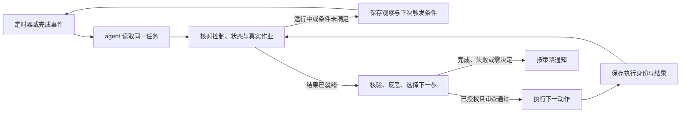

# 监视接入与自动推进

本页说明如何让工作流在任务运行期间持续观察，并在结果出现后推进下一步。它是接入指南；本仓库没有内置常驻调度服务、通知服务或远程作业监督器。

[首页](../README.zh-CN.md) · [架构与状态](design.zh-CN.md) · [运行层 API](runtime.zh-CN.md) · [宿主适配参考](../skills/agent-workflow/references/host-adapters.md)

## 谁负责什么



这是宿主集成的逻辑，不是运行层已经提供的远程作业接口。具体分工如下：

| 部分 | 责任 | 由谁提供 |
|---|---|---|
| 唤醒来源 | 在指定时间、作业完成或依赖满足后触发一次检查 | 现有调度器、队列、CI、宿主自动化功能 |
| 决策者 | 读取真实状态，判断等待、核验、修订或执行 | 使用 skill 的 agent |
| 状态记录 | 保存目标、控制、当前步骤、尝试与证据 | 项目既有记录，或可选 SQLite 运行层 |
| 作业监督 | 提供原生作业身份、状态、退出结果、取消与真实限时 | 本地或远程执行器、任务平台 |
| 通知渠道 | 向指定位置发送需要关注的变化 | 宿主通知工具或事件服务 |

LangGraph 在可选运行层中负责模块路由，不提供定时器。只有 skill 文件时，agent 也需要被宿主调用才会工作。

## 两种接入路径

### 在现有 agent 中接续真实作业

适合已经有训练脚本、CI、批处理队列或进程监督器的项目。

1. 绑定一个明确任务路径和原生执行器。优先使用项目已有控制与状态，不另造一套互相矛盾的“运行中”记录。
2. 每次唤醒读任务目标、当前控制、最近尝试与真实作业状态。
3. 运行中只观察，结束后读取保存产物并核验；满足条件后推进已授权的下一步。
4. 对新的后台动作先保存 attempt 身份和启动意图，再保留执行器返回的作业 ID 与回执。

文件模板和[接续提示](../skills/agent-workflow/assets/resume-prompt.md)可用于组织记录。它们不实现进程锁、状态查询或后台执行，这些需要绑定真实工具。

### 用 Python 运行层控制模块调用

适合需要程序约束阶段、校验回执和拒绝重复调用的集成。

1. 唤醒时打开同一个 `Workflow(directory)`，读取其 SQLite 状态。
2. 用 `tick(handlers)` 或有步数上限的 LangGraph 调用推进当前模块。
3. 同步执行回调等待动作结束，再提交执行身份、证据与实际费用。
4. 达到本次推进上限或出现等待、阻碍、完成状态时返回宿主。

当前回调协议只有完成或失败的执行回执，没有“已提交远程作业、稍后取回结果”的完整异步协议。不能把排队成功当执行完成。需要长期远程作业时，由宿主监督并在回调返回前取得完整结果，或使用上一种接入路径；这不等于仓库自带远程监督器。

## 如何设置一个监视任务

### 1. 先确定监视对象和结束条件

将目标、验收、允许的下一动作和资源限制绑定到同一任务。区分“一次实验结束”和“整体任务完成”。完成后是停止唤醒、保留低频观察还是等待新指令，由任务要求决定。

应能回答：原作业是谁，结果在哪里，什么算达标，什么条件会暂停，以及 agent 在无需再次询问时可以推进哪些行动。常规已授权行动继续执行；新的外部发布等动作仍依实际权限处理。

### 2. 选择真实的状态依据

| 对象 | 应读取什么 | 单独不足以说明什么 |
|---|---|---|
| 本地进程 | PID、启动时间、命令或运行身份，以及监督器的退出信息 | PID 存在不能证明是原进程；PID 消失不能证明成功或从未启动 |
| 队列／远程作业 | 原生 job ID、运行状态、结束回执、输出身份 | 提交成功不能证明运行完成 |
| 结果产物 | 与输入、配置、代码身份绑定的保存结果及验收检查 | 文件名、时间戳或日志里的“完成”不能证明整体达标 |
| 控制与用量 | 当前暂停／停止、授权、剩余限制和实际用量来源 | 旧提示与生成文本不能扩大权限或清零历史费用 |

没有可访问的真实执行状态时，记录这个缺口；不要只从自然语言描述猜测原作业是否结束。

### 3. 设置唤醒来源

优先使用完成事件，让结果出现后尽快核验；再用有界周期检查核对遗漏的事件。只有周期调度时，间隔按状态变化速度、检查成本和响应要求选择，不固定要求每分钟或每半小时。

下面是宿主需要配置的事项，不是本运行层的一组可直接传入参数：

| 宿主设置 | 如何选择 |
|---|---|
| 任务指针 | 始终指向同一任务状态；SQLite 模式指向同一运行目录 |
| 触发方式与间隔 | 完成事件、条件事件或周期检查；匹配任务实际耗时 |
| 单次推进范围 | 限制一次唤醒的工作量；运行层可用 `--steps` 或图的 `max_steps` |
| 重叠与超时 | 同任务重复唤醒如何合并，旧调用怎样观察，何时由执行器终止 |
| 通知策略 | 事件类别、接收位置、正常无变化时的安静约定 |
| 结束策略 | 整体完成、停止或等待条件出现后如何处理后续唤醒 |

使用宿主支持的工具或界面建立调度，保存实际创建或更新回执后才能说监视已启用。不应为了接入而直接改写宿主私有配置。宿主不可持续运行、机器不可访问或没有唤醒能力时，定时推进就尚未具备条件。

### 4. 使用短接续提示

文件模式可以交给宿主如下提示，替换其中的任务路径：

```text
使用 $agent-workflow 接续 .agent-workflow/batch-optimization/。
读取任务约定、当前状态和控制，核对原生执行器与保存结果。
原作业仍在运行时保留它；结束后核验，反思并推进已授权的下一步。
启动状态不明时先核对；保存失败、实际用量、下一行动或等待条件。
仅在完成、失败、实质变化或需要决定时通知，正常无变化保持安静。
```

Python 模式则由可信宿主打开数据库、提供回调和运行控制；不能把文件模式提示中的路径当作 `Workflow` 契约传入。单独的自然语言提示也不能代替锁与实际状态查询。

### 5. 先验证接入，再用于昂贵任务

在可丢弃的合成任务上验证以下行为。它们是接入验收项，不代表这个宿主集成已经完成测试：

| 场景 | 应观察到什么 |
|---|---|
| 两次唤醒同时到达 | 同一个已开始动作不会被自动重启 |
| 正常运行且无变化 | 原作业继续；没有重复启动和无意义通知 |
| 作业完成、结果有效 | 从保存产物核验，再进入反思或约定下一步 |
| 启动后提交结果前中断 | 先核对同一执行身份，不把不明状态当未运行 |
| 用户暂停 | 不启动下一模块；需要终止活动作业时调用原生取消 |
| 整体达到验收 | 交付结果，按结束策略处理监视，不把单轮结束误作目标完成 |

当前软件测试覆盖部分本地状态、并发和中断机制；真实调度、模型行为与通知交付的验证边界见[验证记录](../evals/validation.md)。

## 每次唤醒怎样做决定

| 真实情况 | 接续动作 | 通知 |
|---|---|---|
| 原作业健康运行 | 观察原作业，等待完成事件或下次检查 | 无实质变化时安静 |
| 已完成但尚未核验 | 读取同一尝试的保存结果，运行必要验收 | 结果构成有意义变化时报告 |
| 已核验但未达标 | 区分故障、无效比较与有效负结果，反思后提出具体动作 | 报告失败、重要负结果或方向变化 |
| 原启动结果不明 | 核对旧 worker、回执与实际效果 | 需要介入或发现异常时报告 |
| 等待具体外部条件 | 保存触发条件和下一检查时机 | 不重复报告同一等待 |
| 已暂停或停止 | 遵守当前控制；运行中取消由执行器落实 | 按用户要求确认或报告需处理情况 |
| 整体完成 | 保留证据、交付结果，按策略结束监视 | 完成通知 |

agent 可在作业运行期间处理独立且能改变下一决定的轻量工作，但应避免资源争用和无依据的填充任务。用户直接询问状态时仍应回答。

## 运行层的异常怎样处理

| 返回或状态 | 意义 | 宿主处理 |
|---|---|---|
| `ready` | 还有可推进模块 | 在单次步数和原任务限制内继续 |
| `plan_only` | 到执行阶段，但当前仅允许规划 | 保留待执行状态；有实际授权时由可信宿主设置模式 |
| `pause`／`stop` | 当前控制阻止后续模块 | 不启动新模块；活动调用是否取消由原生执行器处理 |
| `waiting` | 反思选择等待并给出触发条件 | 条件满足后由宿主用明确理由 `unblock` |
| `blocked` | 某个具体前置条件不满足 | 读取 blocker；修复后再恢复，不能无差别定时重试 |
| `reconcile_required` | 有未结束或中断的 claim | 先观察原调用；确认旧 worker 结束后，用原身份的证据核对 |
| `done`／`stopped` | 已是终态 | 交付／保留结果，按监视结束策略处理 |

`reconcile_required` 可能来自仍活着的调用，也可能来自崩溃。不能一看到它就执行 `reconcile`。后者是可信宿主操作，需要先确认旧 worker 不会继续产生效果，再提交同一 token 的真实回执和耗时。

费用未知时先用原证据核对；空间不足时按允许的保留策略处理可重建产物。新目录、再次初始化和通知都不能清零失败用量或绕过限制。

## 通知与接续分别记录

任务状态记录“发生了什么、下一步是什么”；通知记录“哪个事件尝试发送、结果如何”。消息发送失败不应导致重跑实验。无变化的定时检查也不需要生成新反思长文。

当前运行层不提供通知发送或投递去重服务。宿主应使用稳定事件身份关联通知，记录失败并按自身策略处理；外部渠道不支持幂等时，不能承诺消息恰好送达一次。监视进度应依据实际任务推进，而不是通知次数。
