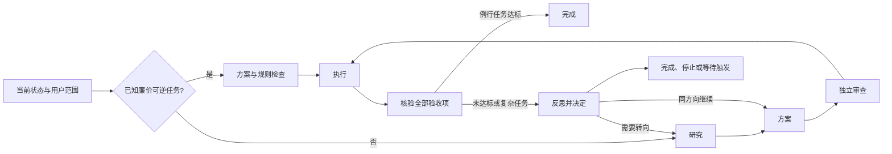

# 流程必要性审查

本次审查从用户如何完成任务出发：每一步必须改变一个决定、验证一个结果，或提供实际执行所需的保障。步骤多、文档齐不等于工作流好。另一方面，删除防重复执行和验收也不会让无人值守任务更可靠。

## 对每一步的决定

| 原有步骤或机制 | 省略后会发生什么 | 本次处理 |
|---|---|---|
| 每轮研究并填两个备选 | 对已知修复常常只是补文字；新研究若省略则可能盲试 | 已知廉价可逆任务跳过；新问题、转向时研究；同方向接续复用证据 |
| 制定方案 | 不知道具体改什么、如何验收、要花多少资源 | 保留，但例行任务不强填科学假设与反证字段 |
| 独立审查方案 | 高成本或不确定任务可能在论据不足时启动 | 复杂任务保留；例行任务在方案提交时做确定性规则检查，不冒称科学审查 |
| 执行前再次检查 | 方案写好后，权限、空间和真实作业可能变化 | 保留启动前检查；它与事前审查检查的是不同时间的事实 |
| 实际执行与保存回执 | 无法分辨已启动、已完成、未执行或中途退出 | 保留；任务已有执行器时直接绑定，不新建竞争控制器 |
| 结果核验 | 进程正常退出也可能交付错误结果 | 两条路线都保留，必须覆盖全部验收项 |
| 每次成功后写反思 | 普通成功可能没有新的认识，只产生重复总结 | 例行任务核验通过即结束；失败/未完成或复杂任务才进入反思 |
| 单独调用接续模块 | 决定已保存，额外推理不能增加信息 | 合并进反思事务，由程序路由，不再调用RESUME回调 |
| 每个推理阶段遍历目录 | 相邻阶段重复扫描运行树，未增加启动保障 | 只在启动前有界遍历；费用、时间及剩余空间仍做轻量检查 |
| 每轮保存新教训 | 相似规则不断累积，检索更难 | 可无新教训；只保存有证据、能避免再犯的认识 |
| 每次唤醒复制历史、汇报无变化 | 增加上下文、文件与通知，没有推进任务 | 读紧凑当前状态，按需取旧证据；正常无变化安静 |
| 并发claim、执行意图与中断核对 | 同一动作可能启动两次；无回执被误当没执行 | 保留原有机制，没有为简化而移除 |
| 真实费用、失败和未知值 | 重新命名或重启后看似还有资源 | 保留原账，不以新目录或重规划清零 |
| 新增调度平台、多代理团队、更多参数 | 当前需求没有证明必须增加它们 | 不新增；使用已有宿主；LangGraph仍为可选路由 |

模块说明文件仍可单独阅读，因为不同领域需要不同实现；它们不是必须产生的报告，也不是必须发起的七次模型调用。公开入口减少重复说明，参数含义集中到一处。

## 两条实际路线



默认采用deliberate，防止未经判断把复杂工作变为例行工作。routine是可信宿主在任务创建时的明确选择，不由模型在某次方案中自行降低要求。两种路线的授权、证据、重复防护和成本核对相同。参数及如何调整见[集中说明](../skills/agent-workflow/references/parameters.md)。

## 使用的外部参考

通过find-skills先查看skills.sh目录，再查simplify与first-principles。以下是2026-11-11查询快照；安装量与仓库star不是质量证明，也不是单个skill的star。

| 来源 | 查询快照 | 与本任务的关系 |
|---|---|---|
| [Cursor：Redesign From First Principles](https://github.com/cursor/plugins/blob/246bc508c139c5e036dfafea8978d31a7433279f/harness/pstack/claude-code/skills/principle-redesign-from-first-principles/SKILL.md) | 约5K安装；仓库15,977 star | 从新需求重看整体设计，并同步修改所有受影响的说明。不是在旧流程后面再加一个“精简步骤” |
| [Compound Engineering：ce-simplify-code](https://github.com/EveryInc/compound-engineering-plugin/blob/40580d82f1a0c5c275ba5c56c85b8c183ab7fe91/skills/ce-simplify-code/SKILL.md) | 约3.6K安装；仓库26,020 star | 参考明确范围、保留行为和证明测试、可解释的参数。它专用于代码，明确不把skill文案当代码；没有把它直接套作设计评审 |
| [Compound Engineering：按实际使用删减计划](https://github.com/EveryInc/compound-engineering-plugin/blob/dd9b7921c9c80498eba84994ff1b8e1e81dbc1db/docs/solutions/skill-design/right-size-plans-by-subtraction-and-a-usage-first-sizing-test.md) | 复用前次固定版本调研 | 先去掉要求无条件加工作量的指令；同时检查是否误删无人值守真正需要的保护 |

这轮没有安装第三方skill，也没有照搬其源码或必须启动多个评审agent的安排。若要自行试用对应技能，可分别运行：

```bash
npx skills add cursor/plugins@principle-redesign-from-first-principles
npx skills add everyinc/compound-engineering-plugin@ce-simplify-code
```

对标是逐项判断是否适用，不是把高星项目全部功能搬来。比如ce-simplify-code的范围、运行模式、尺寸界限和证明测试参数服务于它的代码审查器；本套件应具有自己的努力程度、资源界限和验收参数，而非同名空开关。无需为未实现的模型、通知服务或分布式执行器添加“配置项”。

## 核验与尚未证明的部分

软件测试检查例行成功只调用PLAN/EXECUTE/VERIFY、失败仍反思、转向恢复研究与审查、复杂流程保持原保护；另检查继续时不再重复研究、暂停和证据检查不被精简绕过。具体结果见[验证记录](../evals/validation.md)。

确定可以省去的是这些合成路线中的冗余模块调用；不能据此声称实际任务总时间、token或成本减少多少。尚未运行真实模型的新旧配对行为评测，也不保证不会陷入局部最优。下一步应以固定工具、预算和验收的低成本任务检验误简化与过度思考两种失败，而不是继续添规则。
